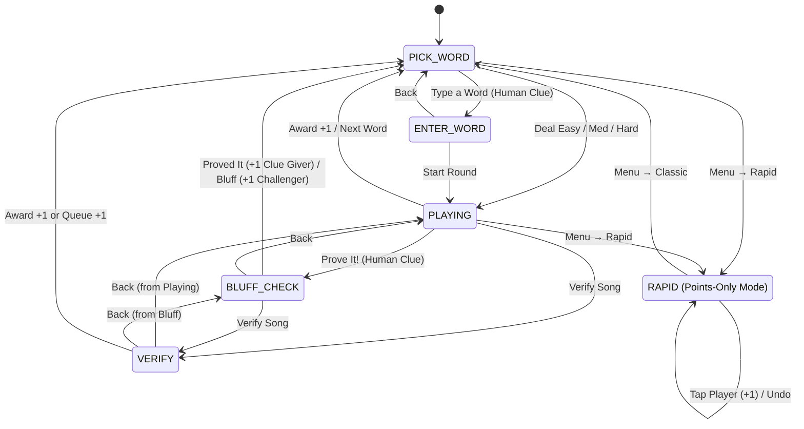
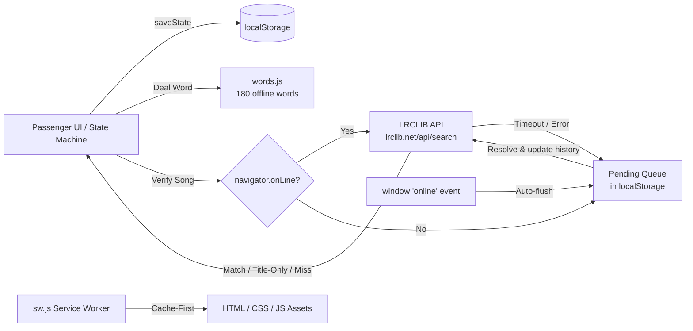

# CarGames Architecture

CarGames is a zero-build, offline-first Progressive Web App (PWA) designed for a passenger operating a phone in a moving car while the driver plays eyes-free.

## Design Invariants
1. **Silent by default:** The app never uses Web Audio or Speech Synthesis, so car radio/podcasts are never interrupted.
2. **Zero timers:** All pacing is human-controlled so traffic spikes or merges never punish a player.
3. **Thumb-first state machine:** Every play screen fits in a single mobile viewport (`100dvh`) with 2–4 oversized buttons (`30%–100%` width, `12%–17%` height). Secondary settings live in the `Menu` overlay.
4. **Offline-first:** All static assets are precached by `sw.js`. Trip state persists in `localStorage`. Network calls (LRCLIB) are strictly optional and degrade into a retry queue.

## File Layout
```text
CarGames/
├── index.html          # App shell, persistent score bar, screen mount, FX canvas
├── styles.css          # Dark car-friendly theme, giant button sizing, animations
├── app.js              # State machine, LRCLIB verifier, offline queue, confetti FX
├── words.js            # Static offline Easy / Medium / Hard word decks (180 words)
├── sw.js               # Service Worker (app-shell cache-first, skips external APIs)
├── manifest.json       # PWA manifest (standalone iPhone Home Screen support)
├── icon.svg            # Vector app icon
├── roadmap.md          # Planned work (TS migration, autocomplete, offline index)
└── docs/
    └── architecture.md # This document
```

## Song Game State Machine



## Timing Metadata (Invisible)
In **Classic** mode, the app records `wordStartedAt` (epoch ms) when a word is submitted or dealt, and saves `elapsedMs` on the history entry when a point is awarded. No countdown or clock is shown during play; elapsed solve time appears quietly in Trip History inside `Menu` and is preserved in `localStorage` for future difficulty calibration.

## Offline & Verification Data Flow



## Word Matching Rules
- Queries `https://lrclib.net/api/search?q=<query>` directly from the browser (CORS `Access-Control-Allow-Origin: *`).
- Filters out instrumental tracks and checks up to 8 candidates, ranking `match` (in lyrics) → `title-only` (in title, not lyrics) → `miss`.
- Uses word-boundary regex (`\b<word>(?:s|es|ed|ing|'s)?\b` when root matching is enabled in Menu, or exact `\b<word>\b`).
- Tracks normalized `title|artist` keys in `usedSongs` to flag repeats across the current trip.
